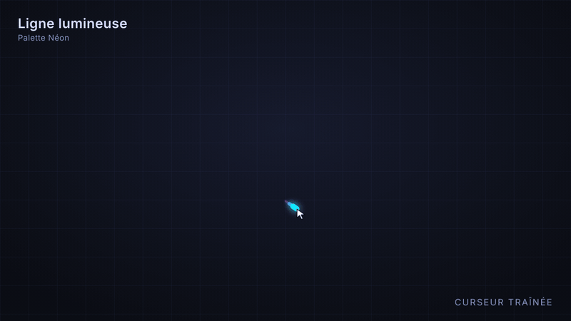

# Cursor App — Curseur Traînée

Application Windows qui affiche une traînée lumineuse derrière le curseur de la souris, sur tout l'écran et par-dessus toutes les applications. Les clics passent à travers : elle ne gêne rien.



## Fonctionnalités

- **3 effets** : ligne lumineuse, points, étincelles.
- **Couleurs libres** (deux sélecteurs), 6 palettes prêtes à l'emploi (Néon, Feu, Océan, Matrix, Violet, Glace) ou arc-en-ciel animé.
- **Longueur, épaisseur et halo** réglables, avec aperçu en direct.
- **Multi-écrans** : la traînée suit la souris d'un écran à l'autre.
- **Icône dans la zone de notification** : réglages, activer / désactiver, lancement au démarrage de Windows.
- **Réglages enregistrés** automatiquement.
- **Respect de la vie privée** : l'application ne se connecte pas à internet et n'envoie aucune donnée.

## Télécharger

Rendez-vous dans l'onglet [Releases](../../releases) et téléchargez `CurseurTrainee.exe`. C'est une version portable : aucune installation, double-cliquez simplement sur le fichier.

### Avertissement de Windows

Le programme n'est pas signé numériquement (le certificat de signature est payant). Au premier lancement, Windows peut afficher « Windows a protégé votre ordinateur » : cliquez sur **Informations complémentaires**, puis sur **Exécuter quand même**. Certains antivirus peuvent aussi le signaler à tort.

Pour vérifier que le fichier téléchargé est intact, comparez son empreinte avec celle indiquée dans la release :

```
certutil -hashfile CurseurTrainee.exe SHA256
```

## Utilisation

Une icône apparaît dans la zone de notification (près de l'horloge, parfois derrière la flèche « ^ »).

- **Clic gauche** : ouvre les réglages.
- **Clic droit** : Réglages, Activer / Désactiver, Lancer au démarrage de Windows, Quitter.
- Relancer le programme alors qu'il tourne déjà ouvre aussi les réglages.

Au tout premier lancement, la fenêtre de réglages s'ouvre toute seule. Les changements s'appliquent immédiatement.

La longueur se mesure en distance parcourue par la souris : 28 correspond à environ 450 pixels, 200 à environ 3200 pixels (pour les étincelles, c'est la durée de vie). La traînée suit le chemin déjà parcouru : elle se remplit à mesure que la souris avance.

Les réglages sont stockés dans `%APPDATA%\Curseur Trainee\settings.json`.

## Fabriquer l'exécutable soi-même

Prérequis : [Node.js](https://nodejs.org) (version LTS).

1. Téléchargez ou clonez ce dépôt.
2. Double-cliquez sur `Creer-exe.bat` (ou lancez `npm install` puis `npm run dist` dans un terminal).
3. `CurseurTrainee.exe` apparaît dans le dossier `dist`.

Pour essayer l'application sans fabriquer l'exécutable : `Lancer-test.bat` (ou `npm start`).

> Sous PowerShell, si `npm` est bloqué (« l'exécution de scripts est désactivée »), utilisez `npm.cmd` à la place, ou l'Invite de commandes.

L'exécutable a l'icône standard d'Electron sur le fichier lui-même ; l'icône de la zone de notification est la bonne. Pour une icône personnalisée sur le fichier, activez le « Mode développeur » de Windows, puis remplacez `"signAndEditExecutable": false` par `true` dans `package.json`.

## Structure du projet

| Fichier | Rôle |
| --- | --- |
| `main.js` | Processus principal : fenêtres transparentes, position du curseur, icône, réglages |
| `preload.js` | Pont sécurisé entre les fenêtres et le processus principal |
| `overlay.html`, `overlay.js` | Fenêtre transparente qui dessine les effets |
| `settings.html`, `settings-ui.js` | Fenêtre de réglages |
| `settings.js` | Valeurs par défaut, validation et sauvegarde des réglages |

## Dépannage

Si rien ne s'affiche, quittez toutes les instances (`taskkill /F /IM CurseurTrainee.exe`, ou `taskkill /F /IM electron.exe` en mode test) puis relancez. Pour un diagnostic, lancez en mode test dans PowerShell :

```
$env:TRAIL_DEBUG="1"; npm.cmd start
```

Un cadre rouge entoure alors l'écran et le terminal décrit ce qui se passe. Si le cadre rouge n'apparaît pas, ajoutez `$env:TRAIL_NOGPU="1";` avant la commande pour couper l'accélération graphique.

## Limites connues

- Windows uniquement.
- Les jeux en plein écran exclusif et certaines fenêtres système (invite UAC, écran de verrouillage) passent au-dessus de l'effet. Les jeux en « fenêtré sans bordure » fonctionnent.
- Les traînées très longues avec un fort halo demandent plus de puissance : baissez le halo si l'ordinateur ralentit.

## Licence

[MIT](LICENSE) — vous pouvez utiliser, modifier et redistribuer ce programme librement, en conservant la mention de copyright.
